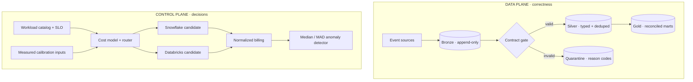

<div align="center">


<br>

[](https://github.com/AnyalstRushi/routelake/actions/workflows/ci.yml)


[](LICENSE)

**[🌐 Project website](https://anyalstrushi.github.io/routelake/)** &nbsp;·&nbsp; **[⚡ Run the demo](#-run-the-demo)** &nbsp;·&nbsp; **[🧭 How it works](#-how-it-works)** &nbsp;·&nbsp; **[📄 Technical report](docs/RouteLake_2026_Technical_Case_Study.md)** &nbsp;·&nbsp; **[🗺️ Roadmap](docs/ROADMAP.md)**

</div>

<br>

> [!IMPORTANT]
> **Honest maturity note.** RouteLake runs locally with Python and SQLite. Live Snowflake/Databricks execution, production-scale performance, and shared Apache Iceberg interoperability are **not yet validated**. Cost figures are illustrative model outputs, not measured savings or vendor quotes.

## The problem

Data teams keep getting the same three questions. RouteLake answers all of them in one explainable control-plane prototype.

| 🛡️ Can I trust this data? | 🧭 Where should it run? | 🔍 Why did spend change? |
|---|---|---|
| Contract validation, reason-coded quarantine, deterministic dedup, late-event flags and reconciliation. | Compares engine and size candidates, filters by latency SLO, and applies hysteresis so placements stay stable. | Normalizes Snowflake and Databricks billing exports and flags unusual spend with median/MAD baselines. |

<div align="center">

**TRUST THE DATA. ROUTE THE WORKLOAD. EXPLAIN THE COST.**

</div>

## ⚡ Run the demo

Python 3.10+ · no third-party Python dependencies · no cloud credentials.

```bash
git clone https://github.com/AnyalstRushi/routelake.git
cd routelake
python -W error -m unittest discover -s tests -v
python -m routelake demo
python -m routelake route
```

The demo writes `reports/latest.md` and `reports/latest.json`, and is deterministic for a fixed seed.

<details>
<summary><b>👀 What the demo prints</b> (from the seeded scenario in <code>reports/latest.md</code>)</summary>

```text
$ python -m routelake demo
Events received ........ 5150   (5000 unique + 150 planted duplicates)
Silver rows ............ 4800
Quarantined ............ 200
Duplicates dropped ..... 150
Late-arriving flagged .. 100
Matches planted ground truth ........ True
Replay of batch-01 was a no-op ...... True
Reconciliation failures ............. 0

$ python -m routelake route
Routed: $171.64/day vs all-on-snowflake: $283.85/day (39.5% lower, 0 SLO misses)
```

</details>

## 🧭 How it works


<details>
<summary>Text version of the diagram (Mermaid)</summary>



</details>

| Capability | What happens | Main implementation |
|---|---|---|
| 🛡️ **Data trust** | Contract validation, reason-coded quarantine, deterministic deduplication, late-event flags, reconciliation | `routelake/contracts.py`, `pipeline.py` |
| 🧭 **Workload placement** | Compares engine/size candidates, filters by latency SLO, applies hysteresis | `routelake/cost_model.py`, `router.py` |
| 🔍 **Spend intelligence** | Normalizes Snowflake and Databricks billing exports; detects unusual spend with median/MAD baselines | `routelake/billing.py`, `anomaly.py` |
| 🎯 **Calibration** | Replaces planning assumptions with measured runtime samples | `routelake/calibrate.py` |

## 📊 Evidence from the seeded local scenario

<div align="center">

| Deterministic fixture | Result |
|:--|--:|
| Input records | **5,150** |
| Quarantined records | **200** |
| Duplicates removed | **150** |
| Late events flagged | **100** |
| Reconciliation failures | **0** |
| Test suite | **73 tests reported** |

</div>

Quarantine reasons, 40 records each: `event_ts:bad_timestamp` · `event_type:not_in_enum` · `price:below_min` · `quantity:below_min` · `user_id:missing`

### Where each workload runs

| Workload | Engine | Size | Runtime (s) | $/day | SLO |
|---|---|---|---:|---:|:--:|
| exec_dashboard_refresh | Snowflake | S | 13 | 57.60 | ✅ |
| adhoc_analyst_queries | Snowflake | S | 30 | 60.00 | ✅ |
| hourly_orders_microbatch | Snowflake | XS | 162 | 4.44 | ✅ |
| nightly_sessionization | Databricks | 2XS | 5722 | 4.54 | ✅ |
| weekly_backfill_rebuild | Databricks | S | 13999 | 32.94 | ✅ |
| churn_model_training | Databricks | 2XS | 4965 | 3.95 | ✅ |
| feature_store_refresh | Databricks | 2XS | 2502 | 8.16 | ✅ |

### Modelled cost comparison

```text
All-Snowflake baseline  ████████████████████████████████████████  $283.85/day
Routed engine mix       ████████████████████████                  $171.64/day   39.5% lower (modelled)
```

> [!NOTE]
> Reproducible configuration example only, not a benchmark, a quote, or realized savings. Calibrate with measured account data before using any estimate for decisions. Planning assumptions are illustrative.

### Spend anomalies found in the fixture

810 usage rows analysed, 2 seeded anomalies (not live incidents):

| Account | Day | Spend | Typical | Multiple | Robust z |
|---|---|---:|---:|---:|---:|
| snowflake / ADHOC_WH | 2026-10-22 | $150.76 | $16.69 | 9.0x | 247.8 |
| databricks / ALL_PURPOSE_COMPUTE | 2026-10-15 | $490.29 | $66.30 | 7.4x | 63.1 |

## ✅ Correctness properties exercised locally

- Replaying an identical batch is a no-op; conflicting reuse of a batch ID is rejected.
- A failed batch transaction rolls back rather than leaving partial state.
- Duplicate handling is deterministic and first-write-wins.
- Reconciliation checks batch arithmetic and Gold-versus-Silver aggregates.
- Routing decisions expose feasibility and use a hysteresis threshold to avoid unnecessary flips.

See [Architecture](docs/ARCHITECTURE.md), [Limitations](docs/LIMITATIONS.md) and the [technical case study](docs/RouteLake_2026_Technical_Case_Study.md) for details and boundaries.

## 🗂️ Repository map

| Path | Purpose |
|---|---|
| `routelake/` | Python implementation |
| `tests/` | Unit, integration and regression tests |
| `config/` · `contracts/` | Workload assumptions and event contract |
| `data/` · `reports/` | Deterministic fixtures and generated outputs |
| `cloud/` | Account-validation guidance and export SQL; not a live integration |
| `docs/` | Architecture, limitations, runbook, technical report and roadmap |
| `site/` | Responsive GitHub Pages project experience |
| `presentations/` | Executive-deck narrative and companion-artifact guide |

## 📚 Project resources

[Project website](https://anyalstrushi.github.io/routelake/) · [Technical case study](docs/RouteLake_2026_Technical_Case_Study.md) · [Architecture](docs/ARCHITECTURE.md) · [Limitations](docs/LIMITATIONS.md) · [Roadmap](docs/ROADMAP.md) · [Open-source readiness](docs/OPEN_SOURCE_READINESS.md) · [Presentation guide](presentations/README.md) · [Original source presentation](docs/RouteLake_Analyst_Rushi.pptx)

## 🛣️ Roadmap

- [x] Local contract-driven Bronze/Silver/Gold pipeline
- [x] Idempotency, quarantine, transaction safety and reconciliation
- [x] Config-driven cost model and SLO-aware router
- [x] Billing normalization and robust anomaly baseline
- [ ] Validate guarded workloads against live Snowflake and Databricks trial accounts
- [ ] Calibrate cost assumptions using measured runtime and billing samples
- [ ] Prototype and verify shared Apache Iceberg interoperability
- [ ] Add scheduler integration, monitoring and production runbooks

## 🤝 Contributing

Issues, reproducible bug reports and focused pull requests are welcome. Start with [CONTRIBUTING.md](CONTRIBUTING.md), review the [Code of Conduct](CODE_OF_CONDUCT.md), and report security concerns using [SECURITY.md](SECURITY.md).

---

<div align="center">

**TRUST THE DATA. ROUTE THE WORKLOAD. EXPLAIN THE COST.**

Built by **Analyst Rushi** · RouteLake / 2026

⭐ If RouteLake helps you think about lakehouse cost and trust, star the repo.

</div>
