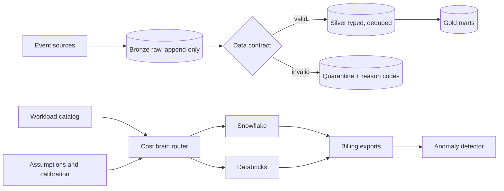

# RouteLake

[](https://github.com/AnyalstRushi/routelake/actions/workflows/ci.yml)

**One dataset. Two engines. One cost brain.**
A cost-aware lakehouse control plane that decides *where* each workload should run (Snowflake or Databricks), proves its data is trustworthy before it runs, and catches runaway spend after.

*Designed and built by **Analyst Rushi**.*

## 2026 flagship experience

RouteLake now includes a standalone, responsive architecture landing page and expanded open-source project guidance.

- **[Technical case study](docs/RouteLake_2026_Technical_Case_Study.md)** — implementation boundaries, data quality guarantees, routing model, anomaly logic and validation roadmap.
- **[Interactive landing page source](site/index.html)** — open-source project overview with a CSS-animated control-plane motif.
- **[Roadmap](docs/ROADMAP.md)** · [Open-source readiness](docs/OPEN_SOURCE_READINESS.md) · [Contributing](CONTRIBUTING.md) · [Security](SECURITY.md)

The landing page is a project explainer, not a live cloud console. GitHub Pages deployment requires Pages to be enabled with **GitHub Actions** as the build source.


**[View the original portfolio deck (PPTX)](docs/RouteLake_Analyst_Rushi.pptx)** — the source presentation is included in the repository. A refreshed 16-slide executive deck is also supplied with the RouteLake 2026 deliverables.

---

## Why this exists

In 2026 almost every serious data team runs Snowflake, Databricks, or both. Writing a pipeline is table stakes. The expensive questions are the ones nobody owns:

1. **Where should this workload run?** The cheapest engine depends on data size, concurrency, latency target, and how often it runs.
2. **Can I trust the data that arrived?** Duplicates, late events and schema drift are normal, not exceptional.
3. **Why did the bill spike on Tuesday?**

RouteLake answers all three with small, explicit, testable code.

## What it does

| Layer | What it gives you | Where |
|---|---|---|
| **Data contracts** | Declarative JSON contract; every rejected record gets machine-readable reason codes | `routelake/contracts.py`, `contracts/` |
| **Medallion pipeline** | Bronze (raw, append-only) -> Silver (typed, deduped, late-flagged) -> Gold (marts). Idempotent batches, quarantine, atomic transactions, reconciliation controls | `routelake/pipeline.py` |
| **Cost brain** | Config-driven runtime + cost model; picks cheapest engine/size that meets the latency SLO, with hysteresis so it does not flap | `routelake/cost_model.py`, `routelake/router.py` |
| **Calibration** | Replace assumptions with *your* measured runs | `routelake/calibrate.py` |
| **Billing adapters** | Normalise `WAREHOUSE_METERING_HISTORY` and `system.billing.usage` exports into one shape | `routelake/billing.py` |
| **Anomaly detection** | Robust (median/MAD) spend spikes with three gates to avoid noisy alerts | `routelake/anomaly.py` |



## Quickstart (no installs, Python 3.10+)

```bash
git clone <your-repo-url> routelake && cd routelake
python3 -m unittest discover -s tests -v     # 73 tests
python3 -m routelake demo                    # full end-to-end run, writes reports/
python3 -m routelake route                   # routing decisions as JSON
```

Zero third-party dependencies by design: it runs the same on a laptop, in CI, or in a locked-down enterprise sandbox.

## What the demo prints (real output, seed 42)

```
pipeline : silver=4800 quarantine=200 dups=150 late=100 ground_truth_match=True recon_failures=0
routing  : $171.64/day vs $283.85/day all-snowflake (39.5% lower), mix={'snowflake': 3, 'databricks': 4}
anomaly  : snowflake/ADHOC_WH spent $150.76 on 2026-10-22 vs a typical $16.69 (9.0x); robust z=247.8
anomaly  : databricks/ALL_PURPOSE_COMPUTE spent $490.29 on 2026-10-15 vs a typical $66.30 (7.4x); robust z=63.1
```

How to read that, honestly:

* **Pipeline numbers are exact, not illustrative.** The generator plants a known number of defects (200), duplicates (150) and late events (100) into 5,150 records. The pipeline must find *exactly* those. A test fails if it is off by one.
* **Routing dollars are illustrative.** They come from `config/assumptions.json`, which is a set of planning assumptions, not vendor quotes or benchmarks. Run `calibrate` on your own measurements before trusting a rupee or a dollar of it.
* **Anomalies are planted** in fixture billing data shaped like the real exports, and the detector must find exactly those two and nothing else (also tested on 25 spike-free seeds).

## How correctness is checked

* **73 tests**, run with warnings as errors, plus an end-to-end CLI test.
* **Ground-truth testing:** planted defects must equal quarantined rows, planted duplicates must equal dropped rows.
* **Independent recomputation:** gold revenue is recomputed in plain Python and compared with the SQL result.
* **Fault injection:** a simulated crash mid-batch must roll back every table, and the retry must succeed.
* **Tamper detection:** deleting a silver row or editing gold must make `reconcile()` fail.
* **Property tests:** across 300 random workloads, hysteresis never makes the routed cost worse than the default engine.
* **Freshness test:** the committed `reports/latest.json` must equal a fresh run, so the docs cannot drift from the code.
* **CI:** GitHub Actions matrix on Python 3.10-3.13 (`.github/workflows/ci.yml`).

Tests were run on Python 3.12 locally for this release. The 3.10, 3.11 and 3.13 jobs run in CI on your first push.

## What is and is not proven

See [`docs/LIMITATIONS.md`](docs/LIMITATIONS.md). Short version: the **logic** is verified locally. It has **not** been executed against live Snowflake or Databricks accounts. SQLite stands in for the warehouse. To validate on real accounts follow [`cloud/RUN_ON_YOUR_ACCOUNTS.md`](cloud/RUN_ON_YOUR_ACCOUNTS.md).

## Repository map

```
routelake/            package (stdlib only)
  events.py           deterministic generator with exact planted defects
  contracts.py        data contract engine
  pipeline.py         bronze/silver/gold, quarantine, reconcile
  cost_model.py       runtime + cost model, config validation
  router.py           SLO-aware engine selection with hysteresis
  billing.py          Snowflake / Databricks export adapters
  anomaly.py          robust spend anomaly detection
  calibrate.py        fit assumptions from measured runs
  fixtures.py         vendor-shaped billing fixtures with planted spikes
  report.py, cli.py   demo orchestration and CLI
config/               assumptions + workload catalog
contracts/            events_v1.json
cloud/                export SQL for real accounts + validation checklist
docs/                 deck (RouteLake_Analyst_Rushi.pptx), architecture, cost model, contracts, runbook, limitations, interview guide
tests/                73 tests
reports/, data/sample generated sample outputs (kept in sync by a test)
```

## Roadmap

1. Shared Apache Iceberg tables read by both engines (the "one dataset, two engines" physical layer).
2. Live benchmark harness that writes calibration samples automatically.
3. Scheduler hook: apply routing decisions to Airflow/Workflows.
4. LLM explainer for anomalies (kept out of v1 on purpose: no non-deterministic code in a cost control path).

---

MIT licensed. Built by **Analyst Rushi**.
