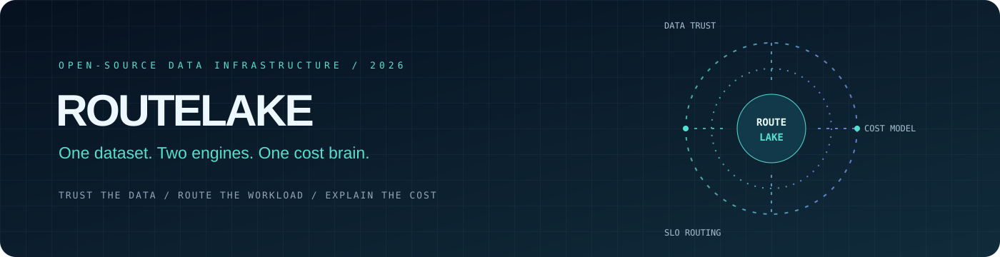
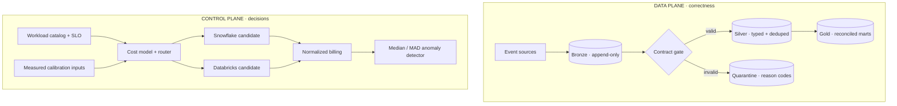

<div align="center">



# RouteLake

### One dataset. Two engines. One cost brain.

**A local-first lakehouse control-plane prototype for data trust, workload placement and spend intelligence.**

[](https://github.com/AnyalstRushi/routelake/actions/workflows/ci.yml)


[](LICENSE)

[**Live cinematic presentation**](https://anyalstrushi.github.io/routelake/presentation.html) · [Presentation source](presentations/routelake-cinematic.html) · [**Project website**](https://anyalstrushi.github.io/routelake/) · [Quickstart](#run-the-demo) · [Architecture](#how-it-works) · [Technical report](docs/RouteLake_2026_Technical_Case_Study.md) · [Roadmap](docs/ROADMAP.md) · [Contributing](CONTRIBUTING.md)

</div>

---

> **The problem:** data teams need to trust incoming data, decide where workloads should run, and understand why platform spend changes. RouteLake brings these decisions into one explainable control-plane prototype.

> **Honest maturity note:** the current implementation runs locally with Python and SQLite. Live Snowflake/Databricks execution, production-scale performance, and shared Apache Iceberg interoperability are not yet validated. Cost figures below are illustrative model outputs, not measured savings or vendor quotes.

## Run the demo

Python 3.10+ · no third-party Python dependencies for the local demo · no cloud credentials required.

```bash
git clone https://github.com/AnyalstRushi/routelake.git
cd routelake
python -W error -m unittest discover -s tests -v
python -m routelake demo
python -m routelake route
```

The end-to-end demo writes `reports/latest.md` and `reports/latest.json`. The demo is deterministic for a fixed seed.

## What RouteLake demonstrates

| Capability | What happens | Main implementation |
|---|---|---|
| **Data trust** | Contract validation, reason-coded quarantine, deterministic deduplication, late-event flags and reconciliation | `routelake/contracts.py`, `pipeline.py` |
| **Workload placement** | Compares engine/size candidates, filters by latency SLO and applies hysteresis | `routelake/cost_model.py`, `router.py` |
| **Spend intelligence** | Normalizes Snowflake and Databricks billing exports; detects unusual spend with median/MAD baselines | `routelake/billing.py`, `anomaly.py` |
| **Calibration** | Replaces planning assumptions with measured runtime samples | `routelake/calibrate.py` |

## Evidence from the seeded local scenario

<div align="center">

| Deterministic fixture | Result |
|:--|--:|
| Input records | **5,150** |
| Quarantined records | **200** |
| Duplicates removed | **150** |
| Late events flagged | **100** |
| Test suite | **73 tests reported** |

</div>

### Modelled cost comparison

| Scenario | Estimated daily cost |
|---|---:|
| All-Snowflake baseline | **$283.85/day** |
| Routed engine mix | **$171.64/day** |
| Difference | **39.5% lower in this configured scenario** |

This is a reproducible configuration example only. It is not a benchmark, a quote, or a claim of realized savings. Calibrate with measured account data before using any cost estimate for decisions. Billing anomalies in the demo are seeded fixtures, not live incidents.

## How it works



### Correctness properties exercised locally

- Replaying an identical batch is a no-op; conflicting reuse of a batch ID is rejected.
- A failed batch transaction rolls back rather than leaving partial state.
- Duplicate handling is deterministic and first-write-wins.
- Reconciliation checks batch arithmetic and Gold-versus-Silver aggregates.
- Routing decisions expose feasibility and use a hysteresis threshold to avoid unnecessary flips.

See [Architecture](docs/ARCHITECTURE.md), [Limitations](docs/LIMITATIONS.md), and the [technical case study](docs/RouteLake_2026_Technical_Case_Study.md) for implementation details and boundaries.

## Repository map

| Path | Purpose |
|---|---|
| `routelake/` | Python implementation |
| `tests/` | Unit, integration and regression tests |
| `config/` · `contracts/` | Workload assumptions and event contract |
| `data/` · `reports/` | Deterministic fixtures and generated outputs |
| `cloud/` | Account-validation guidance and export SQL; not a live integration |
| `docs/` | Architecture, limitations, runbook, technical report and roadmap |
| `site/` | Responsive GitHub Pages project experience |
| `presentations/` | Executive-deck narrative and companion-artifact guide |

## Project resources

- **[Open the RouteLake project website](https://anyalstrushi.github.io/routelake/)**
- **[Technical case study (Markdown)](docs/RouteLake_2026_Technical_Case_Study.md)**
- **[Architecture](docs/ARCHITECTURE.md)** · **[Limitations](docs/LIMITATIONS.md)** · **[Roadmap](docs/ROADMAP.md)**
- **[Open-source readiness](docs/OPEN_SOURCE_READINESS.md)** · **[Presentation guide](presentations/README.md)**
- **[Original source presentation](docs/RouteLake_Analyst_Rushi.pptx)**

## Roadmap

- [x] Local contract-driven Bronze/Silver/Gold pipeline
- [x] Idempotency, quarantine, transaction safety and reconciliation
- [x] Config-driven cost model and SLO-aware router
- [x] Billing normalization and robust anomaly baseline
- [ ] Validate guarded workloads against live Snowflake and Databricks trial accounts
- [ ] Calibrate cost assumptions using measured runtime and billing samples
- [ ] Prototype and verify shared Apache Iceberg interoperability
- [ ] Add scheduler integration, monitoring and production runbooks

## Contributing

Issues, reproducible bug reports and focused pull requests are welcome. Start with [CONTRIBUTING.md](CONTRIBUTING.md), review the [Code of Conduct](CODE_OF_CONDUCT.md), and report security concerns using [SECURITY.md](SECURITY.md).

---

<div align="center">

**TRUST THE DATA. ROUTE THE WORKLOAD. EXPLAIN THE COST.**

Built by **Analyst Rushi** · RouteLake / 2026

</div>
