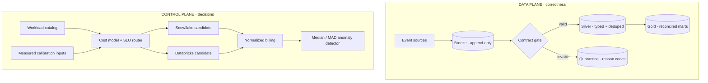

<div align="center">


# RouteLake

### One dataset. Two engines. One cost brain.

**A cost-aware lakehouse control-plane prototype for data trust, workload placement and spend intelligence.**

[](https://github.com/AnyalstRushi/routelake/actions/workflows/ci.yml)


[**Live project experience**](https://anyalstrushi.github.io/routelake/) · [Architecture](docs/ARCHITECTURE.md) · [Technical case study](docs/RouteLake_2026_Technical_Case_Study.md) · [Roadmap](docs/ROADMAP.md)

</div>

> **Maturity boundary:** RouteLake currently demonstrates its control logic locally with Python and SQLite. It has not been validated against live Snowflake or Databricks accounts, production-scale workloads, or a shared Apache Iceberg layer. Cost outputs are illustrative until calibrated with measured account data.

---

## The idea

Most data-platform demos show how to move data. RouteLake explores the decision layer above the platforms:

- **Can I trust the data?** Contracts, quarantine, deterministic deduplication and reconciliation.
- **Where should this workload run?** Compare candidate engine/size plans against cost and latency SLOs.
- **Why did spend change?** Normalize billing exports and detect unusual usage with robust baselines.

The data plane processes records. The control plane evaluates workload placement. Billing observations close the feedback loop.

## System architecture



## Evidence from the deterministic local demo

| Check | Reported result | Interpretation |
|---|---:|---|
| Input records | 5,150 | Seeded deterministic fixture |
| Quarantined records | 200 | 5 planted defect classes × 40 |
| Duplicates removed | 150 | Ground-truth fixture |
| Late events flagged | 100 | Ground-truth fixture |
| Automated tests | 73 | Reported by the project test suite |
| Routed daily cost | $171.64 | Illustrative model output |
| All-Snowflake daily cost | $283.85 | Illustrative comparison baseline |

The modeled 39.5% difference is **not** a vendor quote, measured saving, or independent benchmark. The billing anomalies are planted fixtures, not live incidents. See [limitations](docs/LIMITATIONS.md).

## Run it locally

Python 3.10+; no third-party Python dependencies are required for the current local demo.

```bash
git clone https://github.com/AnyalstRushi/routelake.git
cd routelake
python -W error -m unittest discover -s tests -v
python -m routelake demo
python -m routelake route
```

Inspect `reports/latest.md` and `reports/latest.json` after the demo.

## Repository guide

| Path | Purpose |
|---|---|
| `routelake/` | Contracts, pipeline, cost model, router, billing and anomaly logic |
| `config/` · `contracts/` | Workload assumptions and event contract |
| `cloud/` | Export SQL and guarded account-validation guidance |
| `tests/` | Deterministic, fault-injection and regression tests |
| `reports/` | Reproducible demo outputs |
| `site/` | Static GitHub Pages experience |
| `docs/` | Architecture, contracts, cost model, runbook and limitations |

## Engineering principles

1. **Explainability over magic** — decisions return explicit feasibility and reason information.
2. **Determinism over demos** — seeded fixtures and ground-truth assertions make outcomes reproducible.
3. **Fail safely** — idempotent batches, transaction rollback and reconciliation checks protect local state.
4. **Assumptions are visible** — cost inputs are configuration, not hidden claims.
5. **Roadmap is not reality** — cloud execution and Iceberg interoperability remain future validation work.

## Roadmap

- [x] Local data contracts, Bronze/Silver/Gold pipeline and quarantine
- [x] Config-driven cost model, SLO-aware router and hysteresis
- [x] Billing export normalization and median/MAD anomaly detection
- [x] Local CI and deterministic test coverage
- [ ] Validate export schemas and guarded workloads in live trial accounts
- [ ] Calibrate model with measured runtime and billing samples
- [ ] Prototype shared Apache Iceberg tables and verify cross-engine reads/writes
- [ ] Add scheduler integration and production operations controls after safety validation

## Open source

Read [CONTRIBUTING.md](CONTRIBUTING.md), [CODE_OF_CONDUCT.md](CODE_OF_CONDUCT.md) and [SECURITY.md](SECURITY.md). The project is MIT-licensed; see [LICENSE](LICENSE).

---

<div align="center">

**TRUST THE DATA. ROUTE THE WORKLOAD. EXPLAIN THE COST.**

Built by **Analyst Rushi** · RouteLake / 2026

</div>
