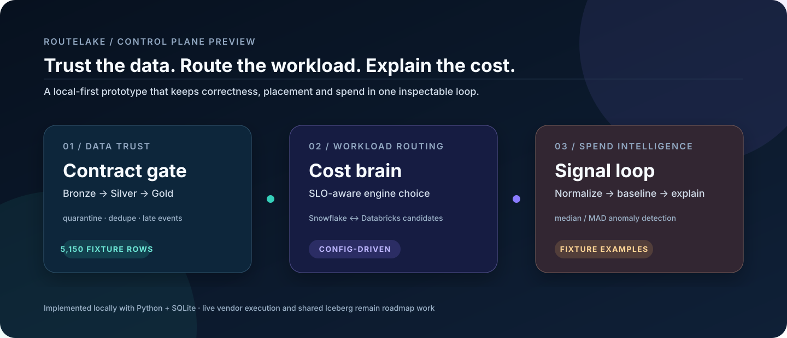
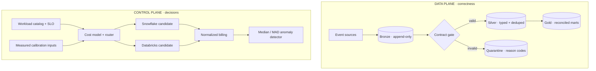

<div align="center">


# RouteLake

### One dataset. Two engines. One cost brain.

**A local-first lakehouse control-plane prototype for data trust, workload placement and spend intelligence.**

[](https://github.com/AnyalstRushi/routelake/actions/workflows/ci.yml)
[](https://anyalstrushi.github.io/routelake/)


[](LICENSE)

[**Live project site**](https://anyalstrushi.github.io/routelake/) · [Quickstart](#run-the-demo) · [Preview](#project-preview) · [Architecture](#how-it-works) · [Evidence](#verified-local-evidence) · [Docs](#docs-navigation)

</div>

---

> **The problem:** data teams need to trust incoming data, decide where workloads should run, and understand why platform spend changes. RouteLake brings these decisions into one explainable control-plane prototype.

> **Honest maturity note:** the current implementation runs locally with Python and SQLite. Live Snowflake/Databricks execution, production-scale performance, and shared Apache Iceberg interoperability are not yet validated. Cost figures below are illustrative model outputs, not measured savings or vendor quotes.

## Project preview

<div align="center">

<a href="docs/RouteLake_Analyst_Rushi.pptx">
  
</a>

**[Open the editable source deck](docs/RouteLake_Analyst_Rushi.pptx)** · **[Read the technical case study](docs/RouteLake_2026_Technical_Case_Study.md)**

</div>

## Run the demo

Python 3.10+ · no third-party Python dependencies for the local demo · no cloud credentials required.

```bash
git clone https://github.com/AnyalstRushi/routelake.git
cd routelake
python -W error -m unittest discover -s tests -v
python -m routelake demo
python -m routelake route
```

The end-to-end demo writes `reports/latest.md` and `reports/latest.json`. The demo is deterministic for a fixed seed.

## What RouteLake demonstrates

| Capability | What happens | Main implementation |
|---|---|---|
| **Data trust** | Contract validation, reason-coded quarantine, deterministic deduplication, late-event flags and reconciliation | `routelake/contracts.py`, `pipeline.py` |
| **Workload placement** | Compares engine/size candidates, filters by latency SLO and applies hysteresis | `routelake/cost_model.py`, `router.py` |
| **Spend intelligence** | Normalizes Snowflake and Databricks billing exports; detects unusual spend with median/MAD baselines | `routelake/billing.py`, `anomaly.py` |
| **Calibration** | Replaces planning assumptions with measured runtime samples | `routelake/calibrate.py` |

## Verified local evidence

<div align="center">

| Deterministic fixture | Result |
|:--|--:|
| Input records | **5,150** |
| Quarantined records | **200** |
| Duplicates removed | **150** |
| Late events flagged | **100** |
| Test suite | **73 tests reported** |
| Routing scenario | **3 Snowflake / 4 Databricks workloads · 0 SLO misses** |

</div>

These are repository-local checks and deck-reported fixture results, not production-scale benchmarks or customer outcomes.

### Illustrative cost comparison — assumptions, not savings

| Scenario | Estimated daily cost |
|---|---:|
| All-Snowflake baseline | **$283.85/day** |
| Routed engine mix | **$171.64/day** |
| Difference | **39.5% lower in this configured scenario** |

The values above come from configured model assumptions in the source deck and repository. They are not vendor pricing, a benchmark, a quote or a claim of realized savings. Calibrate with measured account data before using any estimate for decisions.

### Anomaly examples — fixture data, not incidents

| Fixture date | Workload | Observed vs typical | Robust z-score |
|---|---|---:|---:|
| 2026-10-22 | Snowflake `ADHOC_WH` | **$151 vs $17 · 9.0×** | **248** |
| 2026-10-15 | Databricks `ALL_PURPOSE_COMPUTE` | **$490 vs $66 · 7.4×** | **63** |

These are planted examples from the local scenario. They are not live account alerts or customer incidents.

## How it works




### Correctness properties exercised locally

- Replaying an identical batch is a no-op; conflicting reuse of a batch ID is rejected.
- A failed batch transaction rolls back rather than leaving partial state.
- Duplicate handling is deterministic and first-write-wins.
- Reconciliation checks batch arithmetic and Gold-versus-Silver aggregates.
- Routing decisions expose feasibility and use a hysteresis threshold to avoid unnecessary flips.

## Maturity and boundaries

| Area | Current status |
|---|---|
| Local correctness, routing arithmetic and anomaly logic | Implemented and exercised locally |
| Snowflake / Databricks execution | **Not validated against live vendor accounts** |
| Shared Apache Iceberg tables | **Roadmap; not implemented** |
| Production-scale streaming and operations | **Not validated; SQLite prototype** |
| Cost and throughput figures | **Illustrative assumptions; calibrate before use** |

See [Architecture](docs/ARCHITECTURE.md), [Cost model](docs/COST_MODEL.md), and [Limitations](docs/LIMITATIONS.md) for implementation boundaries.

## Docs navigation

| Resource | Why open it |
|---|---|
| [Technical case study](docs/RouteLake_2026_Technical_Case_Study.md) | End-to-end engineering narrative and evidence boundary |
| [Architecture](docs/ARCHITECTURE.md) | Data plane, control plane and decision flow |
| [Data contracts](docs/DATA_CONTRACTS.md) | Contract rules and quarantine semantics |
| [Cost model](docs/COST_MODEL.md) | Runtime, billing and routing assumptions |
| [Runbook](docs/RUNBOOK.md) | Reproducible local commands and operational notes |
| [Limitations](docs/LIMITATIONS.md) | What is not verified yet |
| [Roadmap](docs/ROADMAP.md) | Next steps toward guarded cloud validation |
| [Source presentation](docs/RouteLake_Analyst_Rushi.pptx) | Editable deck used as the factual source |

## Repository map

| Path | Purpose |
|---|---|
| `routelake/` | Python implementation |
| `tests/` | Unit, integration and regression tests |
| `config/` · `contracts/` | Workload assumptions and event contract |
| `data/` · `reports/` | Deterministic fixtures and generated outputs |
| `cloud/` | Account-validation guidance and export SQL; not a live integration |
| `docs/` | Architecture, limitations, runbook, technical report and roadmap |
| `site/` | Responsive GitHub Pages project experience |
| `presentations/` | Executive-deck narrative and companion-artifact guide |

## Roadmap

- [x] Local contract-driven Bronze/Silver/Gold pipeline
- [x] Idempotency, quarantine, transaction safety and reconciliation
- [x] Config-driven cost model and SLO-aware router
- [x] Billing normalization and robust anomaly baseline
- [ ] Validate guarded workloads against live Snowflake and Databricks trial accounts
- [ ] Calibrate cost assumptions using measured runtime and billing samples
- [ ] Prototype and verify shared Apache Iceberg interoperability
- [ ] Add scheduler integration, monitoring and production runbooks

## Contributing

Issues, reproducible bug reports and focused pull requests are welcome. Start with [CONTRIBUTING.md](CONTRIBUTING.md), review the [Code of Conduct](CODE_OF_CONDUCT.md), and report security concerns using [SECURITY.md](SECURITY.md).

---

<div align="center">

**TRUST THE DATA. ROUTE THE WORKLOAD. EXPLAIN THE COST.**

Built by **Analyst Rushi** · RouteLake / 2026

</div>
